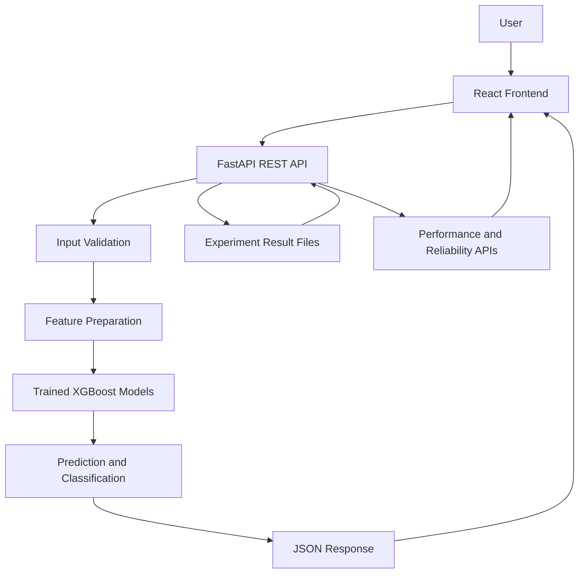

# IoT Intrusion Detection System (IoT-IDS)

### An Imbalance-Aware, Feature-Selected Gradient Boosting Framework for Reliable IoT Intrusion Detection Under Unseen Attack Families

An end-to-end IoT intrusion detection system that combines machine learning, feature-based traffic analysis, experiment evaluation, and a web-based dashboard to explore network intrusion detection under both known and previously unseen attack-family conditions.

The project integrates a React-based frontend with a FastAPI backend, trained XGBoost models, and research experiment results. It provides model-driven prediction capabilities and endpoints for analyzing model performance, unseen-family degradation, reliability, and research findings.

**Frontend:** [Live Demo](https://iot-7saxzy66m-deshma2027-2145s-projects.vercel.app/)

**Frontend Repository:** [CodebyDeshma-27/IoT_IDS](https://github.com/CodebyDeshma-27/IoT_IDS)

**Backend Repository:** [CodebyDeshma-27/IoT_IDS_Backend](https://github.com/CodebyDeshma-27/IoT_IDS_Backend)

> **Deployment status:** The frontend is deployed on Vercel. The FastAPI backend has been tested locally and is being prepared for separate hosting. Full live functionality requires a publicly accessible backend with its required model and experiment-result files.

---

## Table of Contents

- [Overview](#overview)
- [Research Motivation](#research-motivation)
- [Problem Statement](#problem-statement)
- [Research Objectives](#research-objectives)
- [Key Features](#key-features)
- [System Architecture](#system-architecture)
- [Machine Learning Framework](#machine-learning-framework)
- [Technology Stack](#technology-stack)
- [Project Structure](#project-structure)
- [Backend API Reference](#backend-api-reference)
- [Local Installation and Setup](#local-installation-and-setup)
- [Model and Experiment Files](#model-and-experiment-files)
- [Research Evaluation](#research-evaluation)
- [Deployment](#deployment)
- [Limitations](#limitations)
- [Future Enhancements](#future-enhancements)
- [Reproducibility and Responsible Use](#reproducibility-and-responsible-use)
- [Contributing](#contributing)
- [License](#license)
- [Acknowledgements](#acknowledgements)

---

## Overview

The Internet of Things (IoT) connects devices, sensors, gateways, and applications across environments such as smart homes, industrial systems, healthcare, and smart infrastructure. The growing number of connected devices introduces security challenges, including distributed denial-of-service attacks, brute-force attempts, reconnaissance, spoofing, and other malicious network activities.

Traditional intrusion detection approaches may perform well on attack patterns represented during training but can experience performance degradation when encountering previously unseen attack families or changing traffic distributions.

This project investigates an ML-based approach to IoT intrusion detection using a feature-selected gradient boosting framework, with particular attention to:

- Multiclass attack-family classification.
- Binary benign-versus-attack classification.
- Feature-based network traffic analysis.
- Performance under unseen attack-family conditions.
- Reliability evaluation using false-positive and false-negative behaviour.
- Visualization of experiment results through a web interface.

The system combines trained XGBoost classifiers with a FastAPI service and a React frontend to make model predictions and research results accessible through a unified application.

## Research Motivation

A major challenge in intrusion detection is that strong performance on familiar attack classes does not necessarily imply reliable detection of new attack families.

A practical IDS should be evaluated beyond aggregate accuracy. It should also be examined for its ability to distinguish attack categories, maintain detection reliability, control false alarms, and generalize when the evaluation distribution differs from the training distribution.

This project therefore focuses on the relationship between feature selection, gradient boosting, class imbalance, and unseen-family evaluation.

The research explores how these components can contribute to a more informative assessment of ML-based IoT intrusion detection.

## Problem Statement

Machine learning-based intrusion detection systems can be affected by:

1. **Class imbalance:** Some attack classes may be represented more frequently than others, potentially biasing model learning.
2. **Feature dimensionality:** Network traffic can contain many features, and not every feature contributes equally to classification.
3. **Unseen attack families:** A model trained on known attack categories may not generalize reliably to attack families absent from training.
4. **False-positive and false-negative errors:** Incorrectly flagging benign traffic and missing malicious traffic have different operational consequences.
5. **Evaluation transparency:** Aggregate metrics alone may hide degradation across attack families or differences in detection reliability.

The project studies these challenges through a feature-selected XGBoost-based framework and a collection of experiment-analysis endpoints.

## Research Objectives

- Develop a machine learning pipeline for IoT intrusion detection.
- Support multiclass classification of benign traffic and attack families.
- Support binary classification for closed-world benign-versus-attack evaluation.
- Use a selected feature representation and stored training-feature medians.
- Evaluate performance on known and unseen attack-family scenarios.
- Analyze reliability-related metrics, including false-positive and false-negative behaviour.
- Expose model predictions and experiment findings through REST APIs.
- Build a web dashboard for presenting model outputs and research results.
- Establish a reproducible structure for model evaluation and future research extensions.

## Key Features

### Machine Learning

- Multiclass XGBoost classifier.
- Binary XGBoost classifier for closed-world evaluation.
- Stored attack-family label encoder.
- Training-feature median values used during input preparation.
- Feature-based prediction workflow.
- Single-flow prediction support.
- CSV-based batch prediction support.

### Research Analytics

- Core performance analysis.
- Unseen attack-family degradation analysis.
- Reliability and threshold analysis.
- Research summary retrieval.
- Experiment-result tables served from stored evaluation outputs.

### Web Application

- React-based frontend.
- FastAPI REST backend.
- JSON-based API responses.
- Interactive presentation of model outputs and experiment results.
- Separate frontend and backend deployment architecture.

---

## System Architecture

The application follows a frontend–backend–model architecture.



### Architecture Components

| Component | Responsibility |
|---|---|
| React frontend | Presents the user interface, prediction inputs, metrics, and research results. |
| FastAPI backend | Exposes HTTP endpoints, validates requests, loads models, and prepares responses. |
| Multiclass XGBoost model | Predicts among the supported benign and attack-family classes. |
| Binary XGBoost model | Supports binary benign-versus-attack classification. |
| Label encoder | Stores the attack-family class mapping. |
| Training medians | Stores median values for the selected training features. |
| Experiment-result files | Provide stored performance, reliability, unseen-family, and summary data. |

The backend loads the model resources during startup. Its model-loading code checks whether expected files exist and reports whether resources were loaded successfully.

---

## Machine Learning Framework

### 1. Data and Feature Preparation

Network traffic is represented through numerical features supplied to the prediction pipeline. The backend contains feature-preparation logic and stored median values for 20 training features.

The application uses these resources to prepare inputs for model inference.

The exact dataset provenance, complete preprocessing pipeline, training split strategy, and feature-selection procedure should be documented alongside the experiment scripts and research methodology before the project is presented as fully reproducible.

### 2. Multiclass Classification

The multiclass XGBoost model is stored as:

`models/xgboost_tuned_final.json`

The backend loads this model to predict among the supported classes:

- Benign
- Brute Force
- DDoS
- DoS
- Mirai
- Recon
- Spoofing
- Web-based

These are the class labels reported by the currently configured label encoder.

### 3. Binary Classification

The binary XGBoost model is stored as:

`models/xgboost_binary_closed_world.json`

It supports the project's binary classification workflow. The associated closed-world evaluation results are stored separately from the model itself.

### 4. Feature Preparation and Prediction

The backend uses the following resources:

- `attack_family_label_encoder.joblib`
- `training_feature_medians.csv`

The prediction workflow includes model availability checks, input preparation, and model inference. The API also contains a CSV-based batch-prediction endpoint.

### 5. Unseen Attack-Family Evaluation

Unseen-family evaluation investigates how model performance changes when evaluation includes attack families not represented in the corresponding training setup.

The project includes stored evaluation outputs for unseen-family degradation. These outputs can be served through the API for analysis and visualization.

**Important distinction:** A model's ability to classify one of its known classes is not the same as the ability to detect an entirely unknown attack. The evaluation protocol must specify how unseen-family samples are treated and which metrics support any generalization claim.

### 6. Reliability Analysis

The project includes reliability and threshold-analysis outputs, including a table associated with false-positive and false-negative evaluation.

These results help examine the trade-offs between missed attacks and false alarms. No specific numerical performance claims are made here because the actual experimental values must be taken from the generated result files.

---

## Technology Stack

| Layer | Technologies |
|---|---|
| Frontend | React, TypeScript, Vite-based tooling |
| Backend | Python, FastAPI, Uvicorn |
| Machine Learning | XGBoost, scikit-learn |
| Data Processing | pandas, NumPy |
| Model Serialization | joblib |
| API Communication | HTTP, JSON, REST |
| Frontend Hosting | Vercel |
| Backend Hosting | Render planned |
| Version Control | Git, GitHub |

---

## Project Structure

The following structure illustrates the logical organization of the project. The frontend repository intentionally excludes large backend resources and research artifacts.

```text
IoT_IDS/
├── frontend/
│   ├── src/
│   ├── public/
│   ├── package.json
│   ├── package-lock.json
│   └── ...
├── backend/
│   ├── app.py
│   └── requirements.txt
├── models/
│   ├── xgboost_tuned_final.json
│   ├── xgboost_binary_closed_world.json
│   ├── attack_family_label_encoder.joblib
│   └── training_feature_medians.csv
├── results/
│   └── final_analysis/
│       ├── final_core_performance_table.csv
│       ├── final_unseen_family_degradation.csv
│       ├── final_reliability_threshold_table.csv
│       └── final_research_summary.json
├── data/
├── notebooks/
├── .gitignore
└── README.md
```

The actual backend deployment uses a separate repository:

```text
IoT_IDS_Backend_Deploy/
├── app.py
├── requirements.txt
├── render.yaml
├── models/
│   ├── xgboost_tuned_final.json
│   ├── xgboost_binary_closed_world.json
│   ├── attack_family_label_encoder.joblib
│   └── training_feature_medians.csv
└── results/
    └── final_analysis/
        ├── final_core_performance_table.csv
        ├── final_unseen_family_degradation.csv
        ├── final_reliability_threshold_table.csv
        └── final_research_summary.json
```

This is the intended deployment layout; the backend deployment still needs to be tested and hosted publicly.

---

## Backend API Reference

The FastAPI application defines the following endpoints.

| Method | Endpoint | Purpose |
|---|---|---|
| GET | `/` | Root endpoint |
| GET | `/health` | Health and resource-status information |
| GET | `/features` | Selected-feature information |
| GET | `/performance` | Core performance results |
| GET | `/unseen-evaluation` | Unseen-family degradation results |
| GET | `/reliability` | Reliability and threshold results |
| GET | `/summary` | Final research summary |
| Additional | Prediction endpoint(s) | Single-flow model inference |
| Additional | Batch-prediction endpoint | CSV-based batch inference |

The exact request schemas and response structures for prediction endpoints are defined in `backend/app.py`.

### Interactive API Documentation

When the backend is running locally, FastAPI's automatically generated API documentation is available at:

`http://127.0.0.1:8000/docs`

If port 8000 is already occupied, use another available port and open the corresponding URL.

---

## Local Installation and Setup

### Prerequisites

Install the following:

- Python 3.11 or a compatible Python version.
- Node.js and npm.
- Git.
- Access to the required model and experiment-result files.

### 1. Clone the Frontend Repository

```bash
git clone https://github.com/CodebyDeshma-27/IoT_IDS.git
cd IoT_IDS
```

### 2. Install Frontend Dependencies

```bash
cd frontend
npm install
```

Start the frontend using the development script defined in `frontend/package.json`. For a standard Vite development script, this is:

```bash
npm run dev
```

Use the development URL printed by the terminal.

### 3. Prepare the Backend Environment

Return to the project root and create a virtual environment:

```bash
cd ..
python -m venv .venv
```

Activate it on Windows PowerShell:

```powershell
.\.venv\Scripts\Activate.ps1
```

On macOS or Linux:

```bash
source .venv/bin/activate
```

### 4. Install Backend Dependencies

```bash
pip install -r backend/requirements.txt
```

The backend dependencies include:

```text
fastapi
uvicorn
xgboost
pandas
numpy
scikit-learn
joblib
```

### 5. Provide Required Resources

Place the required model files under the root `models/` directory and the required result files under `results/final_analysis/`.

The backend expects the following model files:

- `xgboost_tuned_final.json`
- `xgboost_binary_closed_world.json`
- `attack_family_label_encoder.joblib`
- `training_feature_medians.csv`

It also expects these experiment-result files:

- `final_core_performance_table.csv`
- `final_unseen_family_degradation.csv`
- `final_reliability_threshold_table.csv`
- `final_research_summary.json`

These files are not included in the lightweight frontend repository and must be provided separately.

### 6. Start the Backend

From the project root:

```bash
python -m uvicorn app:app --app-dir backend --host 127.0.0.1 --port 8000
```

If port 8000 is occupied, use port 8001 or another available port.

Open the API documentation:

`http://127.0.0.1:8000/docs`

### 7. Verify Backend Readiness

Check the following endpoints in a browser or API client:

- `/health`
- `/features`
- `/performance`
- `/unseen-evaluation`
- `/reliability`
- `/summary`

Confirm that the required models are loaded and that the experiment endpoints return the expected results.

---

## Model and Experiment Files

### Required Model Resources

| File | Purpose |
|---|---|
| `xgboost_tuned_final.json` | Multiclass XGBoost model |
| `xgboost_binary_closed_world.json` | Binary XGBoost model |
| `attack_family_label_encoder.joblib` | Attack-family label mapping |
| `training_feature_medians.csv` | Stored training-feature medians |

### Required Experiment Results

| File | Purpose |
|---|---|
| `final_core_performance_table.csv` | Core model performance results |
| `final_unseen_family_degradation.csv` | Unseen-family performance degradation |
| `final_reliability_threshold_table.csv` | Reliability and threshold analysis |
| `final_research_summary.json` | Structured research summary |

The model files and result files are runtime dependencies. A successful frontend deployment alone does not make these resources available to the application.

---

## Research Evaluation

The project includes evaluation outputs for the following dimensions:

| Evaluation dimension | Research question |
|---|---|
| Core performance | How does the model perform under the defined evaluation protocol? |
| Multiclass classification | How are benign traffic and the supported attack families classified? |
| Binary classification | How well does the model distinguish benign from malicious traffic in the closed-world setting? |
| Unseen-family degradation | How does performance change when evaluation includes unseen attack families? |
| Reliability | What false-positive and false-negative behaviour is observed? |
| Threshold analysis | How does the selected decision threshold affect reliability? |

### Reporting Experimental Results

For a research review, report the actual values from the generated experiment artifacts. Include:

- Dataset name, source, and version.
- Training, validation, and test split methodology.
- Class distribution and imbalance handling.
- Feature-selection methodology.
- Hyperparameter-selection procedure.
- Evaluation metrics, including precision, recall, F1-score, and relevant false-positive/false-negative rates.
- How unseen attack families are selected and held out.
- Baseline models and comparison methodology.
- Random seeds and experimental environment.
- Limitations and reproducibility details.

Avoid reporting only aggregate accuracy. A rigorous evaluation should explain the experimental protocol and provide the metrics needed to interpret generalization and detection reliability.

---

## Deployment

### Frontend — Vercel

The frontend is deployed at:

**[Open the IoT IDS Dashboard](https://iot-7saxzy66m-deshma2027-2145s-projects.vercel.app/)**

The frontend must use the public URL of the deployed FastAPI backend rather than a localhost address.

For example, a deployed frontend cannot reach a backend through `127.0.0.1:8000` on the developer's computer.

### Backend — Render

The backend is being prepared as a separate Python web service.

The planned startup command is:

```bash
uvicorn app:app --host 0.0.0.0 --port $PORT
```

The backend service must have access to all required model and result files. Its CORS configuration must allow the deployed frontend origin.

### Deployment Checklist

- [x] Frontend deployed to Vercel.
- [x] FastAPI backend tested locally.
- [x] Required model and result files identified.
- [x] Separate backend deployment folder prepared.
- [ ] Backend deployed to a public hosting service.
- [ ] Public backend health endpoint verified.
- [ ] Frontend API base URL updated.
- [ ] Production CORS configuration verified.
- [ ] Live prediction and experiment-result endpoints tested.

---

## Limitations

The following limitations should be considered when interpreting the system:

1. **Dataset dependence:** Results depend on the dataset, its labels, preprocessing, and experimental split.
2. **Unseen-family generalization:** Performance on known classes does not automatically establish reliable detection of novel attacks.
3. **Resource availability:** Model inference and dashboard metrics require the corresponding model and result files.
4. **Runtime constraints:** Hosting limits on memory, CPU, startup time, and persistent storage may affect model loading and prediction performance.
5. **Research validation:** Claims about robustness, generalization, or superiority require appropriate baselines and documented experimental evidence.
6. **Operational security:** A research prototype is not automatically suitable for deployment as a production security-monitoring system.

---

## Future Enhancements

Potential extensions include:

- Adding more diverse IoT attack datasets.
- Evaluating temporal and distribution-shift robustness.
- Comparing additional tree-based and deep-learning models.
- Improving unknown-attack detection and open-set recognition.
- Incorporating explainability methods such as SHAP.
- Adding confidence calibration and uncertainty analysis.
- Implementing drift monitoring and model-version tracking.
- Adding structured experiment tracking and automated evaluation reports.
- Improving backend observability, authentication, and API security.
- Deploying the backend with appropriate persistent storage and resource limits.
- Establishing a fully reproducible training and evaluation pipeline.

These are proposed future enhancements, not claims about existing functionality.

---

## Reproducibility and Responsible Use

This project is intended for research, learning, and defensive cybersecurity experimentation.

For reproducible research:

- Preserve the dataset version and preprocessing procedure.
- Record model hyperparameters and training configuration.
- Document the exact definition of known and unseen attack families.
- Store experiment configurations, evaluation scripts, and generated metrics.
- Avoid modifying the test set based on observed test results.
- Report limitations and negative findings alongside successful results.

For responsible use, evaluate the system only with authorized datasets, controlled test environments, and network traffic that you are permitted to analyze. Predictions should be treated as model outputs rather than definitive proof of malicious activity.

---

## Contributing

Contributions that improve reproducibility, evaluation quality, documentation, model analysis, or defensive detection capabilities are welcome.

A useful contribution should include:

1. A clear description of the change.
2. Reproducible steps or tests.
3. Relevant experiment results, where applicable.
4. Updated documentation for any changed endpoints or model requirements.

For substantial research changes, document the evaluation protocol and compare results under equivalent experimental conditions.

---

## License

No license has been specified yet.

Before reusing, modifying, or redistributing the source code, trained models, or datasets, check their ownership and applicable terms. Add a `LICENSE` file when the intended licensing terms have been decided.

---

## Acknowledgements

This project brings together machine learning, network security, API development, and web application engineering to explore research-oriented IoT intrusion detection.

**Developed by:** Deshma U

**Project focus:** Machine learning-based IoT intrusion detection, unseen attack-family evaluation, and detection reliability.

---

*If you use or extend this work, please document the experimental protocol and cite the relevant dataset, baseline methods, and research sources used in your implementation.*
